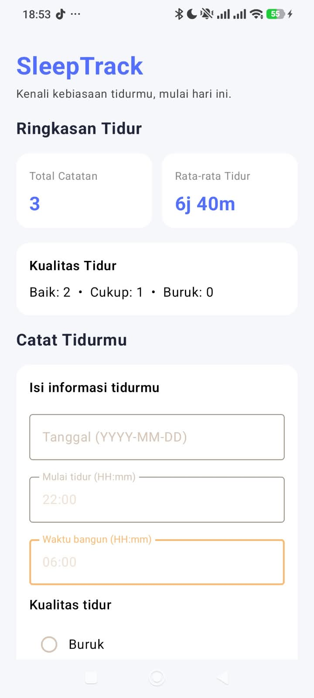
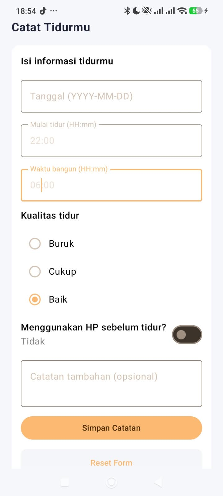
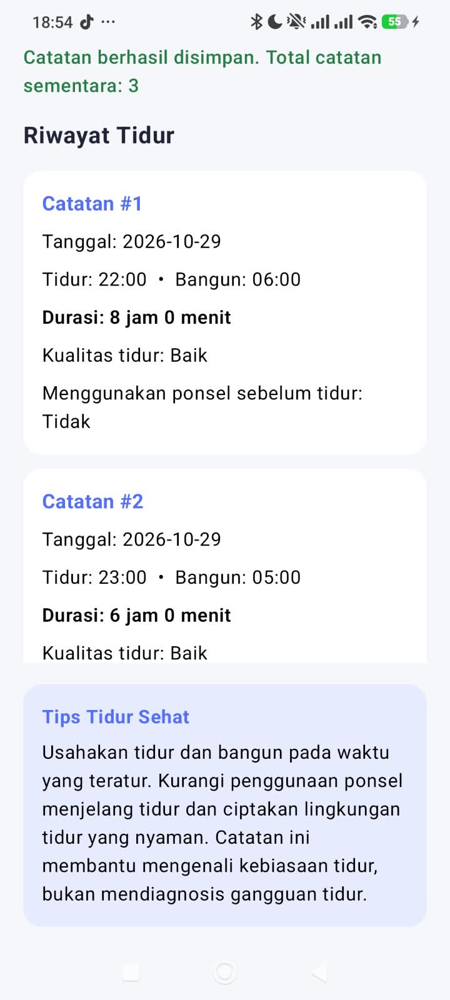

# SleepTrack — Aplikasi Pencatatan Kebiasaan Tidur Sehat

## 1. Informasi Proyek

- **Mata Kuliah:** Pemrograman Bergerak
- **Kode Modul:** HT-04
- **Kelompok:** 4
- **Anggota Kelompok:**
  - Siti Nur Hadiah — 322410015
  - Xander Covelin — 322410017
- **Teknologi:** Kotlin, Jetpack Compose, Material 3

## 2. Deskripsi Aplikasi

SleepTrack merupakan prototipe aplikasi Android untuk mencatat kebiasaan tidur sehari-hari. Pencatatan meliputi tanggal tidur, waktu mulai tidur, waktu bangun, kualitas tidur berdasarkan penilaian subjektif pengguna, penggunaan gawai sebelum tidur, serta catatan tambahan.

Aplikasi ini membantu pengguna melakukan pencatatan dan refleksi sederhana terhadap kebiasaan tidur agar pengguna dapat mengenali pola tidurnya berdasarkan catatan yang tersimpan.

## 3. Masalah dan Pengguna Sasaran

Kebiasaan tidur merupakan bagian dari kehidupan sehari-hari yang dapat dipantau melalui pencatatan sederhana. Tanpa catatan, pengguna mungkin kesulitan mengingat waktu tidur dan bangun serta menilai kebiasaan tidurnya.

SleepTrack ditujukan bagi pengguna yang ingin mencatat dan merefleksikan kebiasaan tidur secara mandiri.

## 4. Fitur Aplikasi

- Formulir untuk mencatat tanggal tidur, waktu mulai tidur, waktu bangun, dan kualitas tidur.
- Pencatatan penggunaan gawai sebelum tidur dan catatan tambahan.
- Validasi input sesuai aturan yang diterapkan aplikasi.
- Perhitungan durasi tidur berdasarkan waktu mulai tidur dan waktu bangun.
- Riwayat catatan tidur dalam daftar.
- Ringkasan jumlah catatan, rata-rata durasi tidur, dan kategori kualitas tidur.
- Informasi edukatif mengenai kebiasaan tidur sehat.

## 5. Teknologi yang Digunakan

- **Kotlin:** bahasa pemrograman aplikasi.
- **Jetpack Compose:** pembuatan antarmuka Android.
- **Material 3:** komponen dan gaya antarmuka.
- **Compose State:** pengelolaan state agar antarmuka diperbarui saat data berubah.
- **LazyColumn:** menampilkan daftar riwayat catatan tidur.
- **Penyimpanan sementara:** data dikelola dalam memori aplikasi tanpa database pada tahap UTS.

## 6. Model Data

Data catatan tidur direpresentasikan menggunakan data class `SleepRecord`, dengan properti:

- `date`: tanggal pencatatan.
- `sleepStart`: waktu mulai tidur.
- `wakeUp`: waktu bangun.
- `quality`: kualitas tidur berdasarkan pilihan pengguna.
- `phoneUsage`: informasi penggunaan gawai sebelum tidur.
- `note`: catatan tambahan.

## 7. Validasi dan Perhitungan

Aplikasi memvalidasi kelengkapan tanggal, validitas waktu tidur dan bangun, serta pilihan kualitas tidur sesuai aturan yang diterapkan.

Durasi tidur dihitung berdasarkan selisih waktu mulai tidur dan waktu bangun. Perhitungan juga menangani kondisi ketika waktu bangun berada pada hari berikutnya.

Ringkasan diperbarui berdasarkan catatan yang tersimpan dalam daftar sementara.

## 8. Cara Menjalankan Aplikasi

1. Clone repository SleepTrack dari GitHub.
2. Buka proyek menggunakan Android Studio.
3. Tunggu hingga proses Gradle Sync selesai.
4. Jalankan aplikasi menggunakan emulator Android atau perangkat Android yang terhubung.
5. Masukkan data melalui formulir pencatatan tidur.
6. Simpan catatan dan periksa riwayat serta ringkasan yang ditampilkan.

## 9. Wireframe dan Screenshot Aplikasi

Wireframe rancangan aplikasi tersedia di `docs/wireframe.png`.

### 9.1 Tampilan Awal

### 9.2 Form Pencatatan Tidur

### 9.3 Riwayat dan Ringkasan

## 10. Pengujian Aplikasi

Skenario pengujian, langkah pengujian, hasil yang diharapkan, hasil aktual, dan status pengujian didokumentasikan dalam [`docs/test-cases.md`](docs/test-cases.md).

Pengujian mencakup kondisi awal aplikasi, input valid dan tidak valid, penambahan beberapa catatan, perhitungan ringkasan, serta tombol reset sesuai skenario pengujian UTS.

## 11. Batasan Aplikasi pada Tahap UTS

- Aplikasi merupakan prototipe untuk pencatatan dan pemantauan kebiasaan tidur.
- Data disimpan sementara di memori aplikasi dan tidak menggunakan database.
- Data sementara tidak dijamin tetap tersedia setelah aplikasi dimulai ulang atau proses aplikasi dihentikan.
- Aplikasi bersifat edukatif dan bukan alat untuk mendiagnosis gangguan tidur.

## 12. Rencana Pengembangan pada Tahap UAS

Pengembangan berikutnya dapat mencakup:

- Penyimpanan permanen menggunakan Room Database.
- Fitur tambah, lihat, ubah, dan hapus catatan tidur.
- Penyaringan catatan berdasarkan tanggal.
- Ringkasan tidur mingguan dan tampilan detail sesuai kebutuhan tahap UAS.

## 13. Dokumentasi Tambahan

- [`docs/test-cases.md`](docs/test-cases.md) — skenario dan hasil pengujian.
- [`CONTRIBUTIONS.md`](CONTRIBUTIONS.md) — kontribusi anggota kelompok.
- [`AI_USAGE.md`](AI_USAGE.md) — dokumentasi penggunaan AI.
